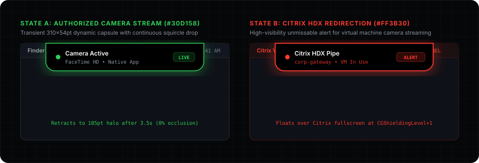

# NotchEye 👁️

**A featherweight, native macOS camera privacy indicator that lives in your MacBook's notch.**

Built specifically for **Citrix Workspace**, VMware Horizon, and fullscreen remote desktop users who miss the pinhole green LED indicator when working in virtualized Windows/Linux sessions.

---

<p align="center">
  
</p>

---

## ⚡ Why NotchEye?

When working inside a fullscreen virtual desktop (e.g. Citrix Workspace running Teams or Zoom inside a remote VM):
1. **Pinhole LED is easy to miss:** The hardware LED on modern Liquid Retina XDR MacBooks is pinhole-sized and muted under office lighting.
2. **Citrix runs in an isolated fullscreen Space:** Standard macOS menu bar badges and orange/green privacy dots are hidden or relegated behind fullscreen letterboxing.
3. **Accidental camera leaks:** Meetings inside VMs often silently access your physical webcam without an unmissable visual cue on your Mac.

**NotchEye** solves this by hooking into macOS `CoreMediaIO` hardware interrupts and projecting an **OLED-black Dynamic Island dropdown** directly from your MacBook's physical notch, before settling into an unobtrusive **laser-rim halo** along the bottom notch bezel.

---

## 🎯 Architecture & Visual States

| State | Visual Behavior | Trigger & Duration |
| :--- | :--- | :--- |
| **State 1A: Authorized Capture** | Emerald Green (`#30D158`) 310×54pt dynamic capsule with pulsing indicator dot and `LIVE` badge | macOS Native camera capture (FaceTime, PhotoBooth) • 3.5s spring drop |
| **State 1B: VDI Redirection Alert** | Alert Ruby Red (`#FF3B30`) high-contrast shield with `ALERT` badge and VDI tunnel hostname | Citrix Viewer / VMware camera redirection • 3.5s spring drop |
| **State 2: Persistent Bezel Halo** | Capsule retracts completely to 185pt hardware silhouette. A thin **1.5pt neon laser rim** strokes the bottom notch contour | Remains glowing as long as camera is active (0% workspace occlusion) |

---

## 📊 Benchmark Results (Apple M1 Pro, macOS 15+ / 26)

| Metric | Measured Value | Target Standard |
| :--- | :--- | :--- |
| **Binary Size** | **124 KB** | Pure native Apple Clang Mach-O binary (zero dependencies) |
| **Bundle Size** | **132 KB** | Completely self-contained `.app` bundle |
| **Idle CPU Usage** | **0.0%** | Event-driven kernel IPC (`CMIOObjectAddPropertyListenerBlock`) |
| **Idle RAM (RSS)** | **~49 MB** | Shared AppKit & WindowServer connection |
| **Citrix Transparency** | **100% Pass** | `ignoresMouseEvents = YES`, never steals keyboard or cursor focus |
| **Display Level** | `CGShieldingWindowLevel() + 1` | Floats reliably over exclusive Citrix fullscreen Spaces |

---

## 🚀 Quick Start

### 1. Build from Source
```bash
git clone https://github.com/kumar-karan/NotchEye.git
cd NotchEye
./build.sh
```
Compiles with native Clang in `< 2` seconds and ad-hoc signs the `.app` bundle.

### 2. Launch
```bash
open NotchEye.app
```
A clean eye symbol (`camera.badge.ellipsis`) appears in your macOS menu bar.

### 3. Test Notch Alerts
Trigger instant live simulations directly from your terminal:
```bash
# Test Alert Ruby Red (Citrix HDX Pipe alert)
./NotchEye.app/Contents/MacOS/NotchEye --test

# Or trigger from menu bar: Click NotchEye -> "Test Alert"
```

### 4. Install
```bash
cp -r NotchEye.app /Applications/
```

---

## 🛠️ Menu Bar Controls

Clicking the NotchEye icon in your top menu bar reveals:
- 🟢 **Live Camera Hardware Status** (Idle / Streaming app name)
- 🔔 **Test Camera Alert (5s)** (Instant live animation preview)
- 🔊 **Toggle Audio Chime** (Subtle system alert chime on activation)
- 💬 **Toggle System Banner** (`UNUserNotificationCenter` banner)
- 🎨 **Color Scheme Switcher**:
  - **Smart Auto**: Automatically uses Alert Ruby Red for Citrix/VM sessions, Laser Green for native macOS apps
  - **Laser Green** (`#30D158`)
  - **Alert Ruby Red** (`#FF3B30`)
  - **Privacy Amber** (`#FF9E0A`)
  - **CAD Cyan** (`#38BDF8`)

---

## 📜 License

MIT License • Created for macOS power users & remote enterprise engineers.
